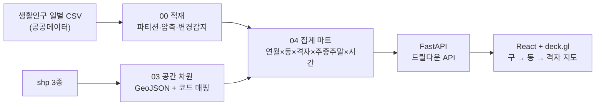

# seoul-living-population-gis

서울시 **250m 격자 생활인구**(공공데이터)를 월·시간·주중주말 단위로 집계해 구 → 행정동 → 격자로 드릴다운하는 **GIS 대시보드**입니다.
적재 → 공간 차원 → 집계 마트 → API → 지도 화면까지 한 사람이 만든 전체 파이프라인이며, 새 데이터가 오면 한 줄(`99.refresh.py`)로 갱신됩니다.

> 공개 데이터(서울 열린데이터광장 생활인구, 상권분석서비스 영역, 250m 격자 shp)만 사용합니다. DB 접속 정보는 `.env`로 분리돼 있고 저장소에는 없습니다.

## 구성

```
01.data/01.raw_data/      서울_시군구 · 서울시 상권분석서비스(영역-행정동) · 서울시_250m격자  (shp, 공개 데이터)
02.script/
  00.input_data.py        생활인구 일별 CSV(CP949, '*' 마스킹) → MySQL  월 단위 RANGE 파티션 + 압축, 신규·변경 파일만 적재
  01.verify_data.py       적재 검증
  02.build_calendar.py    달력 차원(주중/주말, 월별 일수)
  03.build_spatial.py     shp 3종 → WGS84 GeoJSON(지도용) + 코드↔이름 차원 테이블. 격자 CELL_ID·행정동코드 키 정합 검증
  04.build_mart.py        집계 마트(연월×행정동×격자×주중주말×시간, 성별·연령 33컬럼) — 변경 감지로 영향받은 달만 재빌드
  04b/04c                 구 단위 · 구×일 단위 롤업 마트
  99.refresh.py           갱신 오케스트레이터: 원천 동기화 → 바뀐 달만 마트 재빌드
  backend/                FastAPI API 서버 (드릴다운·시간대·성별연령 조회, CORS)
  frontend/               React + Vite + deck.gl/MapLibre 지도 화면, Plotly 차트, Vitest
  docs/                   설계·계획 문서
```

## 흐름



## 실행

```bash
# 1) DB 접속 정보
cp .env.example .env      # DB_HOST / DB_PORT / DB_USER / DB_PASSWORD / DB_NAME

# 2) 데이터 적재 → 차원 → 마트
cd 02.script
python 00.input_data.py --yes
python 02.build_calendar.py && python 03.build_spatial.py && python 04.build_mart.py

# 3) API 서버 (:9601)
cd backend && pip install -r requirements.txt && uvicorn main:app --port 9601

# 4) 화면 (:9600)
cd ../frontend && cp .env.example .env   # VITE_KAKAO_APPKEY 입력
npm install && npm run dev
```

자세한 운영 절차는 `02.script/backend/run.md`에 있습니다.

## 설계 포인트

- **변경 감지형 적재·재빌드**: 파일 해시와 적재 로그로 새로 온 달·바뀐 달만 다시 만든다. 50GB급 원천을 매번 다시 읽지 않는다.
- **마트 한 장으로 조회**: 날(日)은 미리 합치고 시간은 남겨, 대시보드는 마트만 조회한다. 일평균은 달력의 해당 월 주중/주말 일수로 나눈다.
- **키 정합 검증**: 행정동 shp 코드 = 생활인구 행정동코드, 격자 shp CELL_ID = 생활인구 250M 격자 코드를 적재 전에 확인한다.
- 이 저장소는 포트폴리오 [02 공간통계 ESDA](https://github.com/Azmo-Shin/Public_Portfolio/tree/main/02_spatial_esda)의 데이터 기반이 된 코드입니다.
